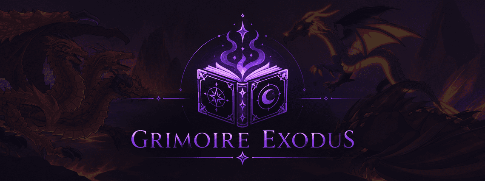

# Grimoire Exodus

Grimoire Exodus is a maintained AQW automation client based on Grimlite Rev. It is developed and maintained by **dsenin**.

Version 1.5.0 adds Grimoire Doctor compatibility checks, a searchable Quick Load GBot window, compact right-aligned toolbar access, and customizable single-key or multi-key shortcuts while preserving legacy `.gbot` compatibility.

> [!WARNING]
> Only download Grimoire Exodus from the [official GitHub Releases page](https://github.com/UnknownSecurity/grimoire-exodus/releases). Third-party mirrors, repacks, and unofficial installers are not maintained or verified by this project and may contain malware, credential stealers, cryptocurrency miners, or other unwanted modifications.

## Compatibility rework

The current build supports AQW's R0048 / Game4000r2.swf client. It restores SmartFox packet capture and current game-version loading, and fixes the packet sniffer, bot-engine cancellation, bot and set loading, travel hotkeys, drop rejection, map-state detection, configuration parsing, plugin startup, current cell and pad discovery, and several stability issues.

The checked-in `game-client/grimoire-exodus.swf` bridge is copied into the application output automatically.

## Build from source

Requirements:

- Windows
- Visual Studio 2022 Build Tools with the .NET desktop build tools workload
- An internet connection for the first build so the hash-pinned app-local Flash and Ruffle runtimes plus NuGet dependencies can be acquired

Use the dedicated Exodus developer CLI from PowerShell:

```powershell
.\exodus.ps1 help
.\exodus.ps1 build -Configuration Debug
.\exodus.ps1 build -Configuration Release
.\exodus.ps1 build -Configuration All
.\exodus.ps1 dev
.\exodus.ps1 runtime
.\exodus.ps1 installer
.\exodus.ps1 version -Part patch
.\exodus.ps1 plugin -Name MyPlugin
.\exodus.ps1 man
```

Builds are written to `app\bin\<Configuration>\Grimoire Exodus.exe`. The CLI verifies and copies `Flash.ocx` beside the executable; Windows activates it through the embedded registration-free COM manifest, without changing the system Flash registration. It also downloads and verifies the allowlisted official Ruffle 0.7.1 web runtime used by the opt-in experimental engine. The CLI preserves the legacy internal `Grimoire` assembly identity required by existing dependencies, while leaving only the branded executable in the final output. `dev` performs a verbose Debug build and launches it directly. `plugin` creates a standalone starter workspace under `plugin-workspaces` unless `-OutputDirectory` is supplied.

`installer` builds Release in an isolated staging directory and creates `dist\Grimoire-Exodus-Setup-1.5.0.msi` with WiX Toolset 3.14.1. Setup offers an optional desktop shortcut and a **Launch Grimoire Exodus** checkbox on its final page. Writable settings, hotkeys, sets, plugins, and the encrypted account vault live under `%LOCALAPPDATA%\Grimoire Exodus`, while user-managed GBots live under `Documents\Grimoire\Bot`, so an installation under Program Files runs without administrator rights. Both WiX and the Flash archive are downloaded into the ignored `.tools` cache and verified with pinned SHA-256 hashes. Tagged GitHub releases publish both the native MSI and a portable ZIP made from the same validated payload.

The compact **Quick Load** toolbar button opens a searchable, scrollable selector that combines official GBots bundled in the release `Bot` directory with user-managed GBots in `Documents\Grimoire\Bot` and sorts them by name. Existing bots from the previous `%LOCALAPPDATA%\Grimoire Exodus\Bots` or portable `Bots` locations are copied into the Documents folder on first use without overwriting files already there.

Startup logs and crash reports are stored under `%LOCALAPPDATA%\Grimoire Exodus`. After an unclean exit, Grimoire can offer to reload the last bot for review, but it never starts that bot automatically. Recovery data is kept separately and does not modify the `.gbot` format, preserving compatibility with older bot files.

When a newer official GitHub release is available, Grimoire shows a download icon in the toolbar with the new version in its tooltip. Selecting it downloads the appropriate portable package or installer in the background, verifies GitHub's SHA-256 digest, then asks before closing and restarting to apply the update. User bots, settings, recovery data, and the legacy `.gbot` format remain untouched.

Experimental multi-client mode is off by default under **Settings → General**. While it is off, every Grimoire launch opens an independent desktop window. While it is on, later launches send an add-client request to the first Grimoire window instead of opening another shell. Restart Grimoire once after changing this mode so the selected startup behavior is active.

## Mobile client

Android development now lives in the independent
[`UnknownSecurity/grimoire-mobile`](https://github.com/UnknownSecurity/grimoire-mobile)
repository. It has its own version history, build pipeline, documentation, and
releases, so mobile changes no longer affect the Windows desktop package. This
repository retains only the language-neutral legacy GBot fixtures used by the
desktop compatibility suite.

## Game engines

Flash.ocx remains the recommended default and compatibility fallback. Settings → Performance now offers an explicit **Ruffle (experimental)** choice for newly created clients. The Ruffle path hosts the official self-hosted runtime in an isolated WebView2 surface, preserves the synchronous bot callback API, forwards AQW assets through a tokenized loopback-only origin, and maps each client's SmartFox sockets through separate bounded WebSocket-to-TCP tunnels. Existing clients are never hot-switched or restarted when the preference changes.

If the verified Ruffle payload or Microsoft Edge WebView2 Runtime is unavailable, Grimoire warns once and creates that client with Flash.ocx. Ruffle is still experimental: use Flash.ocx if a game update exposes an emulator compatibility difference.

The runtime is pinned to Clean Flash build 34.0.0.376 and is third-party legacy software. Do not use it to open untrusted SWFs.

The evaluated alternatives, compatibility constraints, and verification strategy are documented in [docs/embedded-flash-runtime.md](docs/embedded-flash-runtime.md).

## Third-party software

### App-local Flash Player runtime

Grimoire Exodus release packages include an app-local, patched Flash Player ActiveX runtime obtained from the [Clean Flash builds project](https://github.com/darktohka/clean-flash-builds):

- Runtime release: Flash Player 34.0.0.376 (`v1.54`)
- Patch tooling: [FlashPatch](https://github.com/darktohka/FlashPatch)

Flash Player is third-party software and is not covered by Grimoire Exodus's CC0 dedication. Adobe ended general Flash Player support in 2020. The bundled runtime is included solely for compatibility with the legacy AQW client and should not be used to open untrusted SWF content.

### WiX Toolset

The installer build uses [WiX Toolset 3.14.1](https://github.com/wixtoolset/wix3). WiX is downloaded only as a build tool, is not installed with Grimoire Exodus, and is licensed under the Microsoft Reciprocal License (MS-RL).

### Ruffle and WebView2

The experimental engine includes the official [Ruffle](https://github.com/ruffle-rs/ruffle) 0.7.1 self-hosted runtime under its MIT or Apache-2.0 license. Its license files are shipped beside the runtime. The host uses the [Microsoft Edge WebView2 SDK](https://developer.microsoft.com/microsoft-edge/webview2/) 1.0.4314.35; its license and notice are included in release packages. The WebView2 Runtime itself is supplied and serviced by Microsoft.

## Community

- Read [CONTRIBUTING.md](CONTRIBUTING.md) before opening a pull request.
- Participation is governed by the [Code of Conduct](CODE_OF_CONDUCT.md).
- Report vulnerabilities privately by following [SECURITY.md](SECURITY.md).

## Development roadmap

| Status | Feature |
| --- | --- |
| ✅ Completed | Compatibility fixes for the current AQW UI and SWF client |
| ✅ Completed | Grimoire Home with an encrypted, one-click Account Locker |
| ✅ Completed | Conventional commit linting with Commitlint and Husky |
| ✅ Completed | Tag-triggered GitHub Actions release builds |
| ✅ Completed | A native Windows installer with desktop-shortcut and launch-after-setup options |
| ✅ Completed | A bundled native Flash runtime that removes the separate Clean Flash requirement |
| ✅ Completed | Opt-in experimental multi-client mode for up to six independent AQW clients, with per-client bots, state, toolbar effects, safe switching, and an advanced unlimited override |
| ✅ Completed | Opt-in Direct/GPU Flash presentation requests, render-quality controls, active-client FPS, and bot-safe inactive-client throttling |
| ✅ Completed | Verified in-app updates from official GitHub releases |
| ✅ Completed | Startup diagnostics, conservative orphan-state cleanup, tray controls, and crash recovery |
| 🧪 Experimental | An opt-in Flash.ocx / Ruffle engine switcher with a per-client bot bridge and socket adapter |
| ↗ Separate project | Android client development and releases in [`grimoire-mobile`](https://github.com/UnknownSecurity/grimoire-mobile) |
| Planned | A community-maintained bot script repository |

## Credits

- Current development, maintenance, and compatibility rework: **dsenin**
- Original Grimlite Rev maintainer: [GentleGanku](https://github.com/GentleGanku/GrimliteRev)
- Previous Grimlite developers: [wisp](https://github.com/wispie) and [cat](https://github.com/0zl)
- Previous Grimoire developers: [Biney](https://www.mpgh.net/forum/member.php?u=4062680) and [EmperorArts](https://www.mpgh.net/forum/member.php?u=2374072)
- Related projects and contributors: [Grimlite contributors](https://github.com/0zl/meow/graphs/contributors), [RBot](https://github.com/rodit/RBot), and [vtrsz/GrimliteRev](https://github.com/vtrsz/GrimliteRev)
